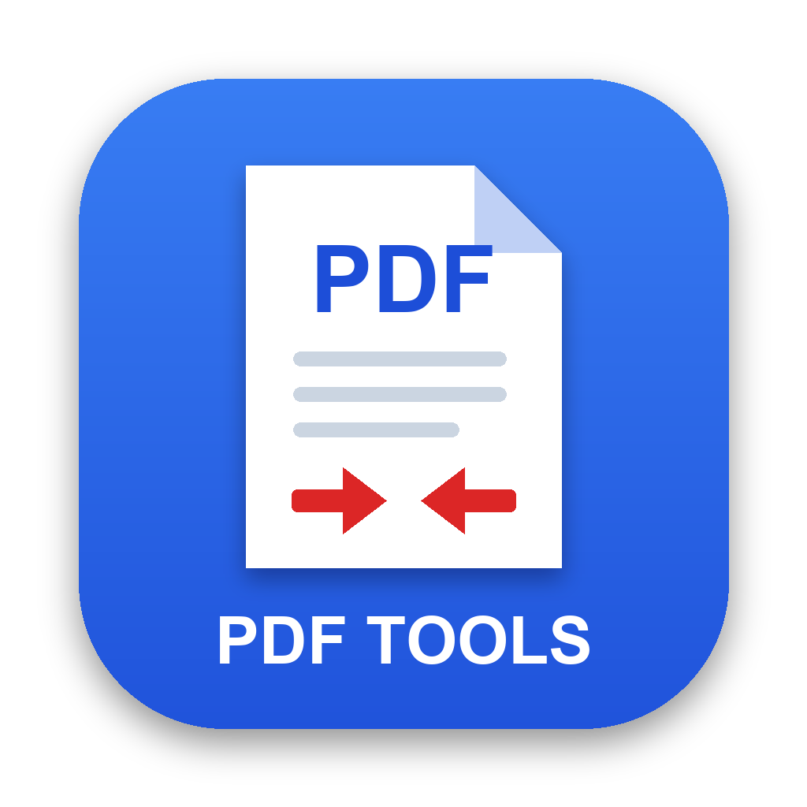

# DocKit

<p align="center"></p>

DocKit is a small desktop app with everyday tools for **PDFs**, **images** and **scans**, similar to free websites such as iLovePDF or iLoveIMG, but everything runs on your computer. Files are never uploaded anywhere.

- **PDF:** compress, merge, split, organize, rotate, remove or extract pages, convert to and from images, page numbers, watermark, protect and unlock.
- **Image:** compress, convert (JPG, PNG, WEBP, GIF, BMP, TIFF, PDF, HEIC input), resize, crop, rotate/flip and watermark.
- **Scan:** turn phone photos of paper into clean scans, or give PDFs and images a scanned look.

> DocKit was first released as "PDF Compressor". The installer replaces the old `PDFCompressor.app` automatically.

## Install

### macOS

Open Terminal (Spotlight → type "Terminal" → Enter) and paste:

```sh
curl -LsSf https://raw.githubusercontent.com/Darshan1510/DocKit/main/install.sh | sh
```

This downloads the latest release, installs it to `~/Downloads`, strips the macOS quarantine flag (so Gatekeeper doesn't block the unsigned app), and launches it.

To update, re-run the same command.

**Why is this needed?** The app isn't signed with an Apple Developer ID, so double-clicking the downloaded `.app` shows a "damaged" or "unidentified developer" dialog. Stripping the quarantine attribute is the standard workaround.

**Want to inspect the script before running it?** You should. View it here: [install.sh](./install.sh).

### Windows

A ready-made Windows download is not available yet. To run it on Windows, use the source code (needs [uv](https://docs.astral.sh/uv/)):

```sh
git clone https://github.com/Darshan1510/DocKit.git
cd DocKit
uv sync
uv run main.py
```

## Troubleshooting (macOS)

**"DocKit is damaged and can't be opened"** after installing manually (not via the script): the quarantine attribute wasn't removed. Run:

```sh
xattr -cr ~/Downloads/DocKit.app
```

**Installer says "Intel Macs are not currently supported"**: only Apple Silicon (arm64) builds are published.

## How to use

### Basic steps (all tools)

1. Open DocKit. The first page shows three choices: **PDF**, **Image** and **Scan**.
2. Click the one that matches what you want to do. You see only the tools for that choice.
3. Click a tool card, for example **Compress PDF**.
4. Drag and drop your file(s) into the box, or click the box to choose files.
5. Set the options in the **Options** panel on the right.
6. Click the blue action button (for example **Compress**).
7. When you see **Done!**, click **Download**. In the desktop app a Save dialog opens; choose where to save the file.
8. Click **Start over** to use the same tool again, or **More tools** to go back to the tool list. The **←** button at the top goes back one level (tool → tool list → home).

Your original files are never changed. The app always saves a new file.

### Step-by-step for each tool

**Compress PDF**
1. Add one or more PDFs.
2. Choose a level: **Light** (best quality), **Balanced** (recommended) or **Strong** (smallest file).
3. For your own values, choose **Custom** and move the **Image DPI** and **JPEG quality** sliders.
4. Optional: tick **Convert images to grayscale** for an even smaller file.
5. Click **Compress**. The result shows the size before and after. Several files download as one `.zip`.

**Merge PDF**
1. Add two or more PDFs.
2. Set the order: drag the files, or use the ↑ and ↓ buttons. The top file comes first.
3. Click **Merge PDFs**.

**Split PDF**
1. Add one PDF. You see thumbnails of all pages.
2. Choose **Every N pages** and enter a number (1 = one file per page), or choose **Custom ranges** and enter ranges such as `1-3, 4, 5-` (`5-` means page 5 to the end).
3. Click **Split PDF**. The parts download as one `.zip`.

**Organize PDF**
1. Add one PDF.
2. Drag the page thumbnails to change the order.
3. Hover a page and click **↻** to rotate it, or **✕** to delete it. Use **Rotate all** or **Reset** if needed.
4. Click **Save changes**.

**Rotate PDF**
1. Add one PDF.
2. Choose **↻ 90°**, **180°** or **↺ 90°**. The thumbnails show a preview.
3. Click **Rotate PDF**.

**Remove pages**
1. Add one PDF.
2. Click each page you want to delete. Selected pages are marked with a red ✕.
3. Click **Remove pages**.

**Extract pages**
1. Add one PDF.
2. Click each page you want to keep. Selected pages are marked with a blue ✓.
3. Click **Extract pages**. Only the selected pages are saved in the new PDF.

**PDF to JPG**
1. Add one PDF.
2. Choose the format (**JPG** or **PNG**) and the quality (**Screen**, **Normal** or **High**).
3. Click **Convert to images**. Several pages download as one `.zip`.

**JPG to PDF**
1. Add one or more images (JPG, PNG, GIF, BMP, TIFF or WEBP).
2. Set the order: drag the images, or use the ↑ and ↓ buttons.
3. Choose the page size (**A4**, **Letter** or **Fit image**) and the margin.
4. Click **Create PDF**.

**Scan to PDF**
1. Add one or more photos of paper documents (JPG, PNG, HEIC and more). Take them from above, with the whole page in the photo.
2. Set the page order: drag the photos, or use the ↑ and ↓ buttons.
3. Optional: click **Adjust** on a photo to check the page corners. Drag the 4 round handles onto the corners of the page, or click **Detect again** or **Whole photo**. Click **Done**.
4. Choose the look: **Black & white** (crisp text, shadows removed), **Grayscale**, **Color (enhanced)** or **Original** (only flattened).
5. Choose **Save as**: **PDF** (then pick the page size: **A4**, **Letter** or **Fit page**), or **JPG** / **PNG** to get each page as a scanned image.
6. Click **Scan**. If the page edges could not be found in a photo, the whole photo is used and the result tells you which one; use **Adjust** to fix it.

**Page numbers**
1. Add one PDF.
2. Choose the position (for example **bottom middle**) and the format (for example `Page 1 of 10`).
3. Optional: change the first number and the font size, or tick **Skip first page (cover)**.
4. Click **Add page numbers**.

**Watermark**
1. Add one PDF.
2. Enter the text (for example `CONFIDENTIAL`).
3. Choose the position, angle, size, opacity and color.
4. Click **Add watermark**.

**Make PDF look scanned**
1. Add one PDF.
2. Choose the effect strength (**Light**, **Medium** or **Strong**), the color (**Grayscale**, **Color** with a paper tone, or **Black & white**) and the quality (**150**, **200** or **300 DPI**).
3. Click **Make it look scanned**. Each page gets a slight tilt, paper tone, blur and grain. Pages become images, so the text can no longer be selected. The same file and settings always give the same result.

**Protect PDF**
1. Add one PDF.
2. Enter a password two times.
3. Click **Protect PDF**. Keep the password safe: it cannot be recovered.

**Unlock PDF**
1. Add a password-protected PDF.
2. Enter its current password.
3. Click **Unlock PDF**. The saved copy has no password.

> A password-protected PDF must be unlocked with **Unlock PDF** before you can use it with the other tools.

The **Image** tools accept JPG, PNG, WEBP, GIF, BMP, TIFF and, on macOS, HEIC/HEIF (iPhone photos; converted to JPG with the built-in `sips` tool). Photos are turned upright first (EXIF orientation). Each result keeps the original file name with a suffix, for example `photo-compressed.jpg`. Several results download as one `.zip`.

**Compress image**
1. Add one or more images.
2. Choose a level: **Light**, **Balanced** (recommended) or **Strong**, or **Custom** and set the quality.
3. Optional: enter a **Target size** in KB. The app lowers the quality, then the size in pixels, until each file fits.
4. Choose the format: **Keep**, **JPG** or **WEBP** (usually the smallest).
5. Leave **Remove metadata** ticked to remove EXIF data such as the camera and GPS location.
6. Click **Compress images**. The result shows the size before and after for each file.

**Convert image**
1. Add one or more images.
2. Choose the format: JPG, PNG, WEBP, GIF, BMP, TIFF, or **PDF (one file)** (then choose the page size).
3. Click **Convert**. Transparent parts become white in JPG and BMP.

**Resize image**
1. Add one or more images.
2. Choose **Percentage** and move the slider, or **Pixels** and enter a width and height (or pick a preset such as Full HD).
3. With **Keep aspect ratio** ticked the image fits inside the width × height; leave one box empty to set only the other.
4. Click **Resize images**.

**Crop image**
1. Add one image.
2. Optional: choose an aspect ratio (**Free**, **1:1**, **4:3**, **16:9** or **3:4**).
3. Drag on the image to draw the crop area. Drag inside it to move it, or drag a corner to resize it. The size in pixels is shown in the Options panel.
4. Click **Crop image**.

**Rotate image**
1. Add one or more images.
2. Choose the rotation and, if needed, tick **Flip horizontally** or **Flip vertically**. The thumbnails show a preview.
3. Click **Rotate images**.

**Make image look scanned**
1. Add one or more images.
2. Choose the effect strength and the color, as for **Make PDF look scanned**.
3. Choose **Save as**: **Keep**, **JPG**, **PNG**, or **PDF** (all images in one PDF, in the order shown).
4. Click **Make it look scanned**.

**Watermark image**
1. Add one or more images.
2. Enter the text, then choose the position (one of 9 places, or **Tiled** to repeat it over the whole image), the angle, the size (as a % of the image), the opacity and the color.
3. Click **Add watermark**.

## Tools

| Category | Tool | What it does |
|---|---|---|
| PDF | Compress PDF | Presets (Light / Balanced / Strong) or Custom DPI and quality |
| PDF | Merge PDF | Combine several PDFs in the order you choose |
| PDF | Split PDF | Every N pages, or custom ranges such as `1-3, 4, 5-` |
| PDF | Organize PDF | Page thumbnails: drag to reorder, rotate or delete pages |
| PDF | Rotate PDF | Rotate all pages 90°, 180° or 270° |
| PDF | Remove pages | Click pages to delete them |
| PDF | Extract pages | Click pages to save as a new PDF |
| PDF | PDF to JPG | Every page as JPG or PNG (zip for several pages) |
| PDF, Image | JPG to PDF | Images to one PDF: A4, Letter or image size, with margins |
| PDF | Page numbers | 6 positions, 4 formats, start number, skip cover page |
| PDF | Watermark | Text, position, angle, size, opacity and color |
| PDF | Protect PDF | AES-256 password encryption |
| PDF | Unlock PDF | Remove a password you know |
| Image | Compress image | Presets or quality, optional target size in KB, JPG/WEBP output, strip EXIF |
| Image | Convert image | To JPG, PNG, WEBP, GIF, BMP, TIFF, or one PDF (HEIC input on macOS) |
| Image | Resize image | By percentage, or width/height with keep aspect ratio and presets |
| Image | Crop image | Drag a box; Free, 1:1, 4:3, 16:9 or 3:4 |
| Image | Rotate image | 90°, 180°, 270°, flip horizontally or vertically |
| Image | Watermark image | Text in 9 positions or tiled, angle, size, opacity, color |
| Scan | Scan to PDF | Photos of paper to a flat, clean scan (B&W, gray, color), as PDF or JPG/PNG |
| Scan | Make PDF look scanned | Tilt, paper tone, blur and grain; 150/200/300 DPI |
| Scan, Image | Make image look scanned | Same effect as for PDFs; images or one PDF |

Links such as `http://127.0.0.1:8010/#image` open a category directly, and `#compress` (or any tool id) opens a tool.

### Compression presets

| Preset   | Image DPI | JPEG quality | Use for                        |
|----------|-----------|--------------|--------------------------------|
| Light    | 200       | 80           | Printing, best image quality   |
| Balanced | 144       | 65           | Email and uploads (default)    |
| Strong   | 96        | 45           | Smallest file, screen only     |
| Custom   | 50–300    | 10–95        | Your own values (sliders)      |

Compression only changes images, so text stays sharp and selectable. There is also a grayscale option.

### How Scan to PDF finds the page

Scan to PDF uses classic computer vision ([OpenCV](https://opencv.org/)): it looks for a bright, four-sided shape with clear edges, flattens it, and cleans it up. There is no AI model, nothing to download, and it works offline. It handles dark or light tables, shadows, tilted photos and a covered or folded corner. It can pick the wrong outline when the page lies on other sheets of paper; use **Adjust** to set the corners by hand.

## Development

```sh
uv sync
uv run main.py
```

### Running in a browser

To use your regular browser instead of the desktop window:

```sh
uv run main.py --browser
```

This starts the local server and opens the app at http://127.0.0.1:8010 in your default browser. Stop it with Ctrl+C.

The server uses port 8010 by default. If that port is busy, set `PORT`:

```sh
PORT=8123 uv run main.py --browser
```

### Building

```sh
make build-mac        # macOS .app bundle in dist/
make build-windows    # Windows .exe directory in dist/
make icon             # Regenerate the app icon (assets/make_icon.py)
```

### Releasing

Releases are built on a Mac and uploaded with the [GitHub CLI](https://cli.github.com/). This does not need GitHub Actions:

```sh
make release-mac VERSION=v0.2.1
```

This builds `DocKit-macOS-arm64.zip` and creates a GitHub release with it. The install script always downloads the latest release.

The GitHub Actions workflow (`.github/workflows/build-release.yml`) also builds the Windows version, but it runs only when started by hand from the Actions tab, and needs Actions billing to be enabled on the account.

### Renaming the GitHub repository

The repository name appears in only two places:

1. `REPO=` in [`install.sh`](./install.sh).
2. The links in this README (search for the current `owner/repo` name and replace it).

Rename the repository on GitHub (Settings → Repository name), update those two places, commit and push. GitHub redirects the old URLs for a while, so older install commands keep working during the switch. The app itself, the build and the release files do not contain the repository name.

## Limitations

- Password-protected PDFs must be unlocked (Unlock PDF) before other tools can use them.
- Watermark and page-number text supports Latin letters only.
- PDFs that contain only text and vector graphics get small savings, because there are no images to recompress.
- 1-bit scanned images (fax/JBIG2) are left as they are; they are already very small.
- HEIC/HEIF photos open on macOS only.
- Images over 100 megapixels are refused. Animated GIF/WEBP files use only the first frame.
- Image watermark text uses a built-in Latin font; other scripts may show as boxes.
- BMP and GIF files cannot be made much smaller in their own format; choose JPG or WEBP in Compress image.

## License

This project is licensed under the [MIT License](LICENSE).

The app uses open-source libraries with their own licenses, including
[pikepdf](https://github.com/pikepdf/pikepdf) (MPL-2.0),
[pypdfium2](https://github.com/pypdfium2-team/pypdfium2) (Apache-2.0 / BSD-3-Clause),
[img2pdf](https://gitlab.mister-muffin.de/josch/img2pdf) (LGPL-3.0),
[ReportLab](https://www.reportlab.com/) (BSD),
[Pillow](https://python-pillow.org/) (MIT-CMU),
[pywebview](https://pywebview.flowrl.com/) (BSD-3-Clause),
[OpenCV](https://opencv.org/) (Apache-2.0),
[NumPy](https://numpy.org/) (BSD-3-Clause),
[FastAPI](https://fastapi.tiangolo.com/) (MIT) and
[Uvicorn](https://www.uvicorn.org/) (BSD-3-Clause).
